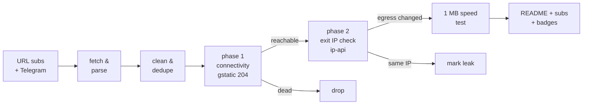

# Free Proxy Scanner

> **Really tested** free proxy aggregator. Every proxy below was fetched from public sources, tunneled through with Xray/sing-box, and verified to actually change your egress IP. No CSV-validation theater, no blind relisting.

      

## What this is

A GitHub Actions pipeline (runs once a day) that fetches free proxy configs from **173 URL subscriptions** and **81 Telegram channels**, parses 9 protocols (vless / vmess / trojan / ss / hysteria2 / hysteria / tuic / socks / http), deduplicates them, and **actually connects through every single one** to separate working proxies from dead ones.

Latest run: **2026-11-24 02:58:43 UTC** — 125986 unique proxies collected from 106/106 URL sources and 9/9 Telegram channels; **4517** endpoints really tested, **1065** reachable, **1017** verified working (egress IP confirmed changed) across **44 exit countries**.

## How the testing works (the *really* part)



1. **Phase 1 — connectivity.** Each proxy is loaded as an outbound into a real Xray or sing-box instance (or used directly via `curl -x` for plain http/socks). An HTTPS request to `gstatic.com/generate_204` goes through the tunnel with **DNS resolved on the proxy side**. Only an HTTP 204 counts as reachable.
2. **Phase 2 — egress verification.** An ip-api request through the same tunnel must return an exit IP **different from the runner's own IP**, plus its country and AS. Proxies that pass phase 1 but keep your IP are marked as leaks and excluded from the working list. Server country vs exit country mismatches are flagged in the tables.
3. **Throughput.** Working proxies download 1 MB from `speed.cloudflare.com` through the tunnel; the measured rate is the speed you see in the tables.
4. **Engine fallback.** If a proxy fails on Xray, it is retried on sing-box (and vice versa) before being declared dead — some configs only work on one core.

## Top working proxies

All 1017 working proxies are published in [`subs/all.txt`](subs/all.txt); this table shows the top 25.

| # | proxy | proto | server | exit | latency | speed | engine |
|---|-------|-------|--------|------|---------|-------|--------|
| 1 | #1 ❓ ?? → 🇺🇸 US | `trojan` | `66.163.122.26:443` | United States | 91 ms | 138.1 Mbps | xray |
| 2 | #2 ❓ ?? → 🇺🇸 US | `trojan` | `66.163.122.30:443` | United States | 62 ms | 132.6 Mbps | xray |
| 3 | #3 ❓ ?? → 🇺🇸 US | `ss` | `45.86.51.18:19999` | United States | 101 ms | 131.9 Mbps | xray |
| 4 | #4 ❓ ?? → 🇺🇸 US | `trojan` | `66.163.122.46:443` | United States | 65 ms | 118.9 Mbps | xray |
| 5 | #5 ❓ ?? → 🇺🇸 US | `trojan` | `66.163.122.25:443` | United States | 63 ms | 111.8 Mbps | xray |
| 6 | #6 ❓ ?? → 🇺🇸 US | `trojan` | `66.163.122.7:443` | United States | 63 ms | 102.1 Mbps | xray |
| 7 | #7 ❓ ?? → 🇺🇸 US | `trojan` | `66.163.122.81:443` | United States | 78 ms | 91.8 Mbps | xray |
| 8 | #8 🇺🇸 US → 🇦🇺 AU | `vmess` | `67.220.95.3:18000` | Australia | 292 ms | 78.7 Mbps | xray |
| 9 | #9 🇺🇸 US → 🇺🇸 US | `ss` | `37.19.198.244:443` | United States | 175 ms | 75.5 Mbps | xray |
| 10 | #10 🇺🇸 US → 🇺🇸 US | `vless` | `159.89.87.21:28190` | United States | 246 ms | 74.3 Mbps | xray |
| 11 | #11 ❓ ?? → 🇺🇸 US | `ss` | `185.230.230.18:19999` | United States | 61 ms | 69.8 Mbps | xray |
| 12 | #12 🇺🇸 US → 🇺🇸 US | `ss` | `37.19.198.243:443` | United States | 84 ms | 67.0 Mbps | xray |
| 13 | #13 ❓ ?? → 🇺🇸 US | `trojan` | `66.163.122.113:443` | United States | 61 ms | 64.1 Mbps | xray |
| 14 | #14 ❓ ?? → 🇺🇸 US | `vmess` | `172.111.38.246:1270` | United States | 89 ms | 63.0 Mbps | xray |
| 15 | #15 🇺🇸 US → 🇺🇸 US | `vless` | `169.40.42.231:443` | United States | 121 ms | 61.4 Mbps | xray |
| 16 | #16 ❓ ?? → 🇺🇸 US | `ss` | `135.148.42.13:8388` | United States | 23 ms | 57.1 Mbps | xray |
| 17 | #17 🇺🇸 US → 🇺🇸 US | `ss` | `37.19.198.236:443` | United States | 76 ms | 55.8 Mbps | xray |
| 18 | #18 ❓ ?? → 🇺🇸 US | `ss` | `149.40.57.135:19999` | United States | 203 ms | 52.4 Mbps | xray |
| 19 | #19 🇺🇸 US → 🇺🇸 US | `vless` | `169.40.42.90:443` | United States | 198 ms | 51.8 Mbps | xray |
| 20 | #20 ❓ ?? → 🇺🇸 US | `ss` | `200.102.179.179:8388` | United States | 54 ms | 47.8 Mbps | xray |
| 21 | #21 ❓ ?? → 🇺🇸 US | `ss` | `136.148.77.250:8388` | United States | 62 ms | 47.0 Mbps | xray |
| 22 | #22 ❓ ?? → 🇺🇸 US | `vless` | `185.95.231.156:443` | United States | 55 ms | 44.6 Mbps | xray |
| 23 | #23 🇺🇸 US → 🇺🇸 US | `ss` | `37.19.198.160:443` | United States | 47 ms | 44.2 Mbps | xray |
| 24 | #24 🇺🇸 US → 🇺🇸 US | `vless` | `169.40.42.89:443` | United States | 126 ms | 41.4 Mbps | xray |
| 25 | #25 ❓ ?? → 🇺🇸 US | `vmess` | `142.202.48.87:1270` | United States | 181 ms | 40.0 Mbps | xray |

## Exit locations — which countries work

Every working proxy, grouped by the country of its **verified exit IP** (phase 2), with a dedicated subscription file per country. Currently 44 countries have at least one working exit.

| country | working | avg speed | best latency | share | list |
|---------|--------:|----------:|-------------:|------:|------|
| 🇺🇸 United States | 305 | 19.1 Mbps | 23 ms | 30% | [`US.txt`](subs/by-country/US.txt) |
| 🇩🇪 Germany | 151 | 5.5 Mbps | 281 ms | 15% | [`DE.txt`](subs/by-country/DE.txt) |
| 🇳🇱 Netherlands | 142 | 7.7 Mbps | 257 ms | 14% | [`NL.txt`](subs/by-country/NL.txt) |
| 🇯🇵 Japan | 75 | 2.7 Mbps | 483 ms | 7% | [`JP.txt`](subs/by-country/JP.txt) |
| 🇨🇦 Canada | 44 | 13.3 Mbps | 77 ms | 4% | [`CA.txt`](subs/by-country/CA.txt) |
| 🇫🇷 France | 37 | 7.2 Mbps | 286 ms | 4% | [`FR.txt`](subs/by-country/FR.txt) |
| 🇸🇬 Singapore | 37 | 3.0 Mbps | 665 ms | 4% | [`SG.txt`](subs/by-country/SG.txt) |
| 🇪🇸 Spain | 22 | 6.2 Mbps | 348 ms | 2% | [`ES.txt`](subs/by-country/ES.txt) |
| 🇬🇧 United Kingdom | 21 | 8.4 Mbps | 245 ms | 2% | [`GB.txt`](subs/by-country/GB.txt) |
| 🇨🇭 Switzerland | 20 | 5.6 Mbps | 325 ms | 2% | [`CH.txt`](subs/by-country/CH.txt) |
| 🇭🇰 Hong Kong | 18 | 3.1 Mbps | 665 ms | 2% | [`HK.txt`](subs/by-country/HK.txt) |
| 🇮🇹 Italy | 15 | 8.2 Mbps | 329 ms | 1% | [`IT.txt`](subs/by-country/IT.txt) |
| 🇸🇪 Sweden | 14 | 7.4 Mbps | 347 ms | 1% | [`SE.txt`](subs/by-country/SE.txt) |
| 🇦🇺 Australia | 12 | 14.8 Mbps | 96 ms | 1% | [`AU.txt`](subs/by-country/AU.txt) |
| 🇧🇾 BY | 10 | 7.3 Mbps | 442 ms | 1% | [`BY.txt`](subs/by-country/BY.txt) |
| 🇫🇮 Finland | 8 | 4.8 Mbps | 432 ms | 1% | [`FI.txt`](subs/by-country/FI.txt) |
| 🇷🇺 Russia | 8 | 4.7 Mbps | 673 ms | 1% | [`RU.txt`](subs/by-country/RU.txt) |
| 🇰🇷 South Korea | 8 | 3.8 Mbps | 654 ms | 1% | [`KR.txt`](subs/by-country/KR.txt) |
| 🇵🇱 Poland | 7 | 6.0 Mbps | 459 ms | 1% | [`PL.txt`](subs/by-country/PL.txt) |
| 🇹🇼 Taiwan | 7 | 3.5 Mbps | 781 ms | 1% | [`TW.txt`](subs/by-country/TW.txt) |
| 🇰🇿 Kazakhstan | 7 | 2.5 Mbps | 1207 ms | 1% | [`KZ.txt`](subs/by-country/KZ.txt) |
| 🇻🇳 Vietnam | 5 | 2.5 Mbps | 1112 ms | 0% | [`VN.txt`](subs/by-country/VN.txt) |
| 🇨🇾 Cyprus | 4 | 6.6 Mbps | 542 ms | 0% | [`CY.txt`](subs/by-country/CY.txt) |
| 🇧🇷 Brazil | 4 | 7.3 Mbps | 531 ms | 0% | [`BR.txt`](subs/by-country/BR.txt) |
| 🇹🇷 Turkey | 4 | 3.2 Mbps | 896 ms | 0% | [`TR.txt`](subs/by-country/TR.txt) |
| 🇮🇳 India | 4 | 1.3 Mbps | 1022 ms | 0% | [`IN.txt`](subs/by-country/IN.txt) |
| 🇦🇹 Austria | 3 | 8.1 Mbps | 348 ms | 0% | [`AT.txt`](subs/by-country/AT.txt) |
| 🇿🇦 South Africa | 3 | 4.1 Mbps | 827 ms | 0% | [`ZA.txt`](subs/by-country/ZA.txt) |
| 🇦🇪 UAE | 3 | 1.3 Mbps | 834 ms | 0% | [`AE.txt`](subs/by-country/AE.txt) |
| 🇨🇿 Czechia | 2 | 7.1 Mbps | 504 ms | 0% | [`CZ.txt`](subs/by-country/CZ.txt) |
| 🇺🇦 Ukraine | 2 | 6.8 Mbps | 637 ms | 0% | [`UA.txt`](subs/by-country/UA.txt) |
| 🇮🇷 Iran | 2 | 5.7 Mbps | 437 ms | 0% | [`IR.txt`](subs/by-country/IR.txt) |
| 🇲🇾 Malaysia | 2 | 4.2 Mbps | 731 ms | 0% | [`MY.txt`](subs/by-country/MY.txt) |
| 🇳🇴 Norway | 1 | 8.9 Mbps | 348 ms | 0% | [`NO.txt`](subs/by-country/NO.txt) |
| 🇱🇹 Lithuania | 1 | 8.0 Mbps | 547 ms | 0% | [`LT.txt`](subs/by-country/LT.txt) |
| 🇷🇴 Romania | 1 | 7.4 Mbps | 581 ms | 0% | [`RO.txt`](subs/by-country/RO.txt) |
| 🇬🇷 Greece | 1 | 6.4 Mbps | 945 ms | 0% | [`GR.txt`](subs/by-country/GR.txt) |
| 🇧🇬 Bulgaria | 1 | 4.7 Mbps | 833 ms | 0% | [`BG.txt`](subs/by-country/BG.txt) |
| 🇹🇭 Thailand | 1 | 1.1 Mbps | 5922 ms | 0% | [`TH.txt`](subs/by-country/TH.txt) |
| 🇱🇻 Latvia | 1 | 0.7 Mbps | 3248 ms | 0% | [`LV.txt`](subs/by-country/LV.txt) |
| 🇵🇦 PA | 1 | - | 221 ms | 0% | [`PA.txt`](subs/by-country/PA.txt) |
| 🇦🇱 AL | 1 | - | 464 ms | 0% | [`AL.txt`](subs/by-country/AL.txt) |
| 🇮🇩 Indonesia | 1 | - | 928 ms | 0% | [`ID.txt`](subs/by-country/ID.txt) |
| 🇳🇬 NG | 1 | - | 3206 ms | 0% | [`NG.txt`](subs/by-country/NG.txt) |

A `??` exit means the geo lookup could not resolve the exit IP. Base64 variants of every country file sit next to them as `<CC>.base64.txt`.

## Protocol distribution

| protocol | tested | alive | working | alive rate |
|----------|-------:|------:|--------:|-----------:|
| `vless` | 2767 | 531 | 492 | 19% |
| `ss` | 585 | 243 | 240 | 42% |
| `vmess` | 930 | 166 | 162 | 18% |
| `trojan` | 157 | 76 | 75 | 48% |
| `hysteria2` | 73 | 47 | 46 | 64% |
| `socks` | 3 | 2 | 2 | 67% |
| `http` | 2 | 0 | 0 | 0% |

Per-protocol working lists: [`subs/by-proto/`](subs/by-proto/) (one `vless.txt`, `vmess.txt`, ... per protocol, plus `.base64.txt` variants).

## Engine breakdown

Which core verified each working proxy. The engine fallback means a proxy that failed on its primary core got a second chance on the other one.

| engine | working | note |
|--------|--------:|------|
| Xray-core | 868 | [`allxray.txt`](subs/by-engine/allxray.txt) |
| sing-box | 147 | [`allsingbox.txt`](subs/by-engine/allsingbox.txt) |
| direct (curl) | 2 | plain http/socks, [`alldirect.txt`](subs/by-engine/alldirect.txt) |

## Speed & latency profile

| speed tier | proxies |
|-----------|--------:|
| >= 5 Mbps | 578 |
| 1 - 5 Mbps | 272 |
| 0.25 - 1 Mbps | 60 |
| < 0.25 Mbps | 0 |
| unmeasured | 107 |

Latency (phase-1 HTTPS round trip): median **491 ms**, p90 **4475 ms**. 48 proxies passed connectivity but failed egress verification (leaked the runner IP or broke on the exit check) and are excluded.

## Source health

115 active, 139 auto-retired (10 fetch failures / 10 all-dead runs / 10 days without anything new). Best contributors this run:

| source | kind | tested | alive | new this run |
|--------|------|-------:|------:|-------------:|
| `SK` | url | 1152 | 598 | 6422 |
| `NK` | url | 1082 | 549 | 290 |
| `EV` | url | 688 | 545 | 61 |
| `HP` | url | 488 | 425 | 163 |
| `AN` | url | 290 | 274 | 56 |
| `AG-PL` | url | 487 | 265 | 855 |
| `F0` | url | 260 | 245 | 19 |
| `Ni` | url | 336 | 244 | 113 |
| `RD-SS` | url | 489 | 232 | 390 |
| `EV-VL` | url | 333 | 222 | 681 |
| `RD-VL` | url | 2209 | 212 | 3420 |
| `EV-SS` | url | 228 | 212 | 129 |
| `HC` | url | 1172 | 205 | 416 |
| `ET` | url | 329 | 195 | 1859 |
| `ST-VL` | url | 2154 | 173 | 570 |
| `RD-VM` | url | 565 | 135 | 3917 |
| `SB-VL` | url | 2011 | 109 | 0 |
| `SB` | url | 2191 | 91 | 0 |
| `HC-VM` | url | 444 | 86 | 935 |
| `ST-VM` | url | 538 | 85 | 32 |

## History

working per run (last 30): ▆▇▆▆▆█▇▆▆▆▆▆█▆▆▇█████████████▇

| date (UTC) | tested | alive | working | avg | max |
|------------|-------:|------:|--------:|----:|----:|
| 2026-11-24 03:38 | 4517 | 1065 | 1017 | 10.5M | 138.1M |
| 2026-11-22 03:38 | 4516 | 1213 | 1159 | 10.1M | 139.3M |
| 2026-11-21 03:33 | 4514 | 1155 | 1120 | 11.2M | 128.3M |
| 2026-11-20 03:37 | 4517 | 1203 | 1171 | 8.6M | 61.0M |
| 2026-11-19 03:39 | 4520 | 1168 | 1134 | 10.2M | 73.9M |
| 2026-11-17 03:38 | 4521 | 1198 | 1174 | 10.0M | 83.1M |
| 2026-11-16 03:41 | 4523 | 1137 | 1100 | 10.3M | 83.4M |
| 2026-11-14 03:41 | 4514 | 1104 | 1067 | 10.7M | 135.5M |
| 2026-11-13 03:31 | 4507 | 1150 | 1119 | 9.4M | 56.3M |
| 2026-11-12 03:35 | 4512 | 1209 | 1166 | 7.0M | 73.5M |
| 2026-11-11 03:35 | 4521 | 1141 | 1102 | 10.1M | 108.1M |
| 2026-11-10 03:31 | 4511 | 1098 | 1052 | 8.2M | 76.8M |
| 2026-11-09 03:34 | 4509 | 1081 | 1046 | 7.6M | 96.5M |
| 2026-11-08 03:39 | 4502 | 1098 | 1068 | 7.7M | 107.7M |
| 2026-11-07 03:34 | 4503 | 1040 | 994 | 7.6M | 82.2M |

## Subscription files

Everything under [`subs/`](subs/) is regenerated every run. Plain lists are one proxy URI per line; `.base64.txt` variants are the same list base64-encoded for clients that need the classic sub format.

| file | contents | direct subscription URL |
|------|----------|--------------------------|
| [`all.txt`](subs/all.txt) | ALL working proxies, ranked by speed (1017) | `https://raw.githubusercontent.com/onlyactions/proxy-scanner/main/subs/all.txt` |
| [`all.base64.txt`](subs/all.base64.txt) | same, base64 | `https://raw.githubusercontent.com/onlyactions/proxy-scanner/main/subs/all.base64.txt` |
| [`top150.txt`](subs/top150.txt) | top 150 ranked (150) | `https://raw.githubusercontent.com/onlyactions/proxy-scanner/main/subs/top150.txt` |
| [`top150.base64.txt`](subs/top150.base64.txt) | same, base64 | `https://raw.githubusercontent.com/onlyactions/proxy-scanner/main/subs/top150.base64.txt` |
| [`by-proto/`](subs/by-proto/) | one list per protocol (6 protocols) | ...`/subs/by-proto/<proto>.txt` |
| [`by-engine/allxray.txt`](subs/by-engine/allxray.txt) | verified on Xray (868) | `https://raw.githubusercontent.com/onlyactions/proxy-scanner/main/subs/by-engine/allxray.txt` |
| [`by-engine/allsingbox.txt`](subs/by-engine/allsingbox.txt) | verified on sing-box (147) | `https://raw.githubusercontent.com/onlyactions/proxy-scanner/main/subs/by-engine/allsingbox.txt` |
| [`by-country/`](subs/by-country/) | one list per exit country (44 countries, e.g. [`US.txt`](subs/by-country/US.txt), [`DE.txt`](subs/by-country/DE.txt)) | ...`/subs/by-country/<CC>.txt` |
| [`sing-box-client.json`](subs/sing-box-client.json) | top 150 as a ready-to-run sing-box client config | `https://raw.githubusercontent.com/onlyactions/proxy-scanner/main/subs/sing-box-client.json` |
| [`xray-client.json`](subs/xray-client.json) | top 150 as a ready-to-run xray client config | `https://raw.githubusercontent.com/onlyactions/proxy-scanner/main/subs/xray-client.json` |
| [`archive/`](archive/) | gz snapshot of every collection (30 kept) | — |

## Use the proxies

- **v2rayN / v2rayNG / Nekobox / Hiddify / Shadowrocket**: add subscription `https://raw.githubusercontent.com/onlyactions/proxy-scanner/main/subs/all.base64.txt` (everything working) or `https://raw.githubusercontent.com/onlyactions/proxy-scanner/main/subs/top150.base64.txt` (curated top 150).
- **Want a specific country?** Grab `subs/by-country/<CC>.txt` (see the Exit locations table above) — e.g. `https://raw.githubusercontent.com/onlyactions/proxy-scanner/main/subs/by-country/US.txt`, `https://raw.githubusercontent.com/onlyactions/proxy-scanner/main/subs/by-country/DE.txt`.
- **Only one protocol?** `subs/by-proto/<proto>.txt` — e.g. `https://raw.githubusercontent.com/onlyactions/proxy-scanner/main/subs/by-proto/vless.txt`, `https://raw.githubusercontent.com/onlyactions/proxy-scanner/main/subs/by-proto/hysteria2.txt`.
- **sing-box**: download [`subs/sing-box-client.json`](subs/sing-box-client.json) and run `sing-box run -c sing-box-client.json` — it listens on `127.0.0.1:2080` (mixed) with a selector + auto urltest group.
- **Xray**: download [`subs/xray-client.json`](subs/xray-client.json), socks inbound on `127.0.0.1:2080`.
- Raw snapshots of every collection: [`archive/`](archive/) (30 kept).

## Repository layout

```
sources/            url_subs.yml + telegram.yml (scannable source lists)
scripts/            collect.py, test.py, report.py + lib/
state/              source health, alive-recall pool, geo cache (committed)
data/               stats, history, compact last-run results
subs/               THE PRODUCT: verified working proxies, split by
                    proto / engine / exit country + all + top150 lists
badges/             shields.io endpoint badges
archive/            gz snapshots of every collection
```

## Why most "free proxy lists" lie

The typical aggregator relists whatever it scraped, so 80-95% of entries are dead within hours — this run found **76% unreachable** and **77% unusable** overall. Only tunnels that completed a real HTTPS handshake, returned a verifiable foreign exit IP, and pushed a 1 MB download are counted as working here.

## Disclaimers

- Free proxies are **public and untrusted**. Anything you send through them can be observed or modified by their operators. Never use them for authentication, payments, or anything sensitive.
- All configs are collected from publicly posted sources (GitHub subscriptions and public Telegram channels); no credentials are guessed or brute-forced. Removal requests: open an issue.
- Availability is transient: the working list is re-verified daily, and past performance never guarantees future availability.

