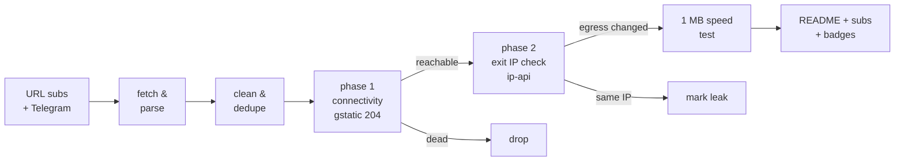

# Free Proxy Scanner

> **Really tested** free proxy aggregator. Every proxy below was fetched from public sources, tunneled through with Xray/sing-box, and verified to actually change your egress IP. No CSV-validation theater, no blind relisting.

      

## What this is

A GitHub Actions pipeline (runs once a day) that fetches free proxy configs from **173 URL subscriptions** and **81 Telegram channels**, parses 9 protocols (vless / vmess / trojan / ss / hysteria2 / hysteria / tuic / socks / http), deduplicates them, and **actually connects through every single one** to separate working proxies from dead ones.

Latest run: **2026-11-10 02:56:17 UTC** — 178555 unique proxies collected from 173/173 URL sources and 81/81 Telegram channels; **4511** endpoints really tested, **1098** reachable, **1052** verified working (egress IP confirmed changed) across **51 exit countries**.

## How the testing works (the *really* part)



1. **Phase 1 — connectivity.** Each proxy is loaded as an outbound into a real Xray or sing-box instance (or used directly via `curl -x` for plain http/socks). An HTTPS request to `gstatic.com/generate_204` goes through the tunnel with **DNS resolved on the proxy side**. Only an HTTP 204 counts as reachable.
2. **Phase 2 — egress verification.** An ip-api request through the same tunnel must return an exit IP **different from the runner's own IP**, plus its country and AS. Proxies that pass phase 1 but keep your IP are marked as leaks and excluded from the working list. Server country vs exit country mismatches are flagged in the tables.
3. **Throughput.** Working proxies download 1 MB from `speed.cloudflare.com` through the tunnel; the measured rate is the speed you see in the tables.
4. **Engine fallback.** If a proxy fails on Xray, it is retried on sing-box (and vice versa) before being declared dead — some configs only work on one core.

## Top working proxies

All 1052 working proxies are published in [`subs/all.txt`](subs/all.txt); this table shows the top 25.

| # | proxy | proto | server | exit | latency | speed | engine |
|---|-------|-------|--------|------|---------|-------|--------|
| 1 | #1 ❓ ?? → 🇺🇸 US | `trojan` | `66.163.112.31:443` | United States | 177 ms | 76.8 Mbps | xray |
| 2 | #2 ❓ ?? → 🇺🇸 US | `trojan` | `66.163.112.242:443` | United States | 51 ms | 64.0 Mbps | singbox |
| 3 | #3 ❓ ?? → 🇺🇸 US | `vless` | `148.135.86.162:10000` | United States | 948 ms | 63.4 Mbps | xray |
| 4 | #4 ❓ ?? → 🇺🇸 US | `vmess` | `23.150.152.65:1270` | United States | 251 ms | 53.3 Mbps | xray |
| 5 | #5 ❓ ?? → 🇺🇸 US | `trojan` | `66.163.112.13:443` | United States | 95 ms | 53.2 Mbps | xray |
| 6 | #6 🇺🇸 US → 🇺🇸 US | `vmess` | `129.146.77.248:39495` | United States | 152 ms | 52.2 Mbps | xray |
| 7 | #7 ❓ ?? → 🇺🇸 US | `vless` | `143.246.62.191:8443` | United States | 76 ms | 50.3 Mbps | singbox |
| 8 | #8 🇺🇸 US → 🇺🇸 US | `ss` | `173.244.56.6:443` | United States | 3099 ms | 47.7 Mbps | xray |
| 9 | #9 ❓ ?? → 🇺🇸 US | `trojan` | `66.163.112.121:443` | United States | 34 ms | 45.5 Mbps | xray |
| 10 | #10 ❓ ?? → 🇺🇸 US | `ss` | `38.145.220.193:8443` | United States | 45 ms | 45.2 Mbps | xray |
| 11 | #11 ❓ ?? → 🇺🇸 US | `ss` | `95.215.201.18:19999` | United States | 51 ms | 42.5 Mbps | xray |
| 12 | #12 ❓ ?? → 🇺🇸 US | `ss` | `23.150.152.38:19999` | United States | 67 ms | 41.1 Mbps | xray |
| 13 | #13 ❓ ?? → 🇺🇸 US | `trojan` | `66.163.112.171:443` | United States | 29 ms | 40.6 Mbps | xray |
| 14 | #14 ❓ ?? → 🇺🇸 US | `vless` | `136.0.197.99:49520` | United States | 49 ms | 38.8 Mbps | xray |
| 15 | #15 🇺🇸 US → 🇺🇸 US | `ss` | `173.244.56.9:443` | United States | 87 ms | 38.6 Mbps | xray |
| 16 | #16 ❓ ?? → 🇺🇸 US | `vless` | `107.173.237.146:8443` | United States | 76 ms | 38.4 Mbps | xray |
| 17 | #17 ❓ ?? → 🇺🇸 US | `trojan` | `66.163.112.142:443` | United States | 75 ms | 37.8 Mbps | xray |
| 18 | #18 ❓ ?? → 🇺🇸 US | `vmess` | `172.67.137.158:443` | United States | 230 ms | 37.2 Mbps | xray |
| 19 | #19 ❓ ?? → 🇺🇸 US | `vmess` | `www.shopify.com:443` | United States | 197 ms | 36.5 Mbps | xray |
| 20 | #20 ❓ ?? → 🇺🇸 US | `vmess` | `172.64.145.93:443` | United States | 286 ms | 36.1 Mbps | xray |
| 21 | #21 ❓ ?? → 🇺🇸 US | `vless` | `198.2.251.107:45197` | United States | 97 ms | 35.7 Mbps | xray |
| 22 | #22 ❓ ?? → 🇺🇸 US | `ss` | `103.11.76.248:28679` | United States | 726 ms | 35.6 Mbps | xray |
| 23 | #23 ❓ ?? → 🇺🇸 US | `trojan` | `167.88.61.193:443` | United States | 217 ms | 33.7 Mbps | xray |
| 24 | #24 🇺🇸 US → 🇺🇸 US | `vmess` | `129.146.143.80:48111` | United States | 28 ms | 33.6 Mbps | xray |
| 25 | #25 🇺🇸 US → 🇺🇸 US | `trojan` | `167.88.61.175:443` | United States | 204 ms | 32.6 Mbps | xray |

## Exit locations — which countries work

Every working proxy, grouped by the country of its **verified exit IP** (phase 2), with a dedicated subscription file per country. Currently 51 countries have at least one working exit.

| country | working | avg speed | best latency | share | list |
|---------|--------:|----------:|-------------:|------:|------|
| 🇺🇸 United States | 301 | 16.6 Mbps | 28 ms | 29% | [`US.txt`](subs/by-country/US.txt) |
| 🇳🇱 Netherlands | 166 | 5.5 Mbps | 396 ms | 16% | [`NL.txt`](subs/by-country/NL.txt) |
| 🇩🇪 Germany | 82 | 5.1 Mbps | 415 ms | 8% | [`DE.txt`](subs/by-country/DE.txt) |
| 🇯🇵 Japan | 65 | 2.3 Mbps | 336 ms | 6% | [`JP.txt`](subs/by-country/JP.txt) |
| 🇨🇦 Canada | 45 | 7.2 Mbps | 204 ms | 4% | [`CA.txt`](subs/by-country/CA.txt) |
| 🇬🇧 United Kingdom | 39 | 5.2 Mbps | 397 ms | 4% | [`GB.txt`](subs/by-country/GB.txt) |
| 🇸🇬 Singapore | 32 | 3.5 Mbps | 534 ms | 3% | [`SG.txt`](subs/by-country/SG.txt) |
| 🇫🇷 France | 30 | 5.0 Mbps | 433 ms | 3% | [`FR.txt`](subs/by-country/FR.txt) |
| 🇵🇱 Poland | 25 | 3.1 Mbps | 630 ms | 2% | [`PL.txt`](subs/by-country/PL.txt) |
| 🇰🇷 South Korea | 21 | 5.0 Mbps | 496 ms | 2% | [`KR.txt`](subs/by-country/KR.txt) |
| 🇫🇮 Finland | 18 | 3.8 Mbps | 489 ms | 2% | [`FI.txt`](subs/by-country/FI.txt) |
| 🇪🇸 Spain | 17 | 5.5 Mbps | 493 ms | 2% | [`ES.txt`](subs/by-country/ES.txt) |
| 🇮🇹 Italy | 17 | 5.4 Mbps | 487 ms | 2% | [`IT.txt`](subs/by-country/IT.txt) |
| 🇸🇪 Sweden | 17 | 4.4 Mbps | 483 ms | 2% | [`SE.txt`](subs/by-country/SE.txt) |
| 🇨🇭 Switzerland | 15 | 5.3 Mbps | 457 ms | 1% | [`CH.txt`](subs/by-country/CH.txt) |
| 🇧🇾 BY | 15 | 5.1 Mbps | 563 ms | 1% | [`BY.txt`](subs/by-country/BY.txt) |
| 🇭🇰 Hong Kong | 12 | 3.7 Mbps | 485 ms | 1% | [`HK.txt`](subs/by-country/HK.txt) |
| 🇧🇬 Bulgaria | 11 | 4.2 Mbps | 697 ms | 1% | [`BG.txt`](subs/by-country/BG.txt) |
| 🇹🇷 Turkey | 10 | 2.9 Mbps | 810 ms | 1% | [`TR.txt`](subs/by-country/TR.txt) |
| 🇲🇩 Moldova | 9 | 3.4 Mbps | 1004 ms | 1% | [`MD.txt`](subs/by-country/MD.txt) |
| 🇦🇺 Australia | 8 | 7.8 Mbps | 156 ms | 1% | [`AU.txt`](subs/by-country/AU.txt) |
| 🇷🇸 Serbia | 8 | 3.8 Mbps | 915 ms | 1% | [`RS.txt`](subs/by-country/RS.txt) |
| 🇮🇷 Iran | 7 | 3.1 Mbps | 1378 ms | 1% | [`IR.txt`](subs/by-country/IR.txt) |
| 🇮🇳 India | 7 | 2.9 Mbps | 982 ms | 1% | [`IN.txt`](subs/by-country/IN.txt) |
| 🇱🇻 Latvia | 6 | 4.4 Mbps | 704 ms | 1% | [`LV.txt`](subs/by-country/LV.txt) |
| 🇪🇪 Estonia | 6 | 4.6 Mbps | 632 ms | 1% | [`EE.txt`](subs/by-country/EE.txt) |
| 🇺🇦 Ukraine | 5 | 3.9 Mbps | 689 ms | 0% | [`UA.txt`](subs/by-country/UA.txt) |
| 🇷🇴 Romania | 5 | 2.7 Mbps | 758 ms | 0% | [`RO.txt`](subs/by-country/RO.txt) |
| 🇦🇪 UAE | 5 | 3.9 Mbps | 963 ms | 0% | [`AE.txt`](subs/by-country/AE.txt) |
| 🇰🇿 Kazakhstan | 5 | 3.3 Mbps | 1625 ms | 0% | [`KZ.txt`](subs/by-country/KZ.txt) |
| 🇲🇽 Mexico | 4 | 13.9 Mbps | 198 ms | 0% | [`MX.txt`](subs/by-country/MX.txt) |
| 🇷🇺 Russia | 4 | 4.4 Mbps | 581 ms | 0% | [`RU.txt`](subs/by-country/RU.txt) |
| 🇦🇹 Austria | 4 | 5.6 Mbps | 483 ms | 0% | [`AT.txt`](subs/by-country/AT.txt) |
| 🇨🇿 Czechia | 4 | 4.4 Mbps | 637 ms | 0% | [`CZ.txt`](subs/by-country/CZ.txt) |
| 🇹🇼 Taiwan | 4 | 3.1 Mbps | 611 ms | 0% | [`TW.txt`](subs/by-country/TW.txt) |
| 🇧🇷 Brazil | 2 | 5.4 Mbps | 675 ms | 0% | [`BR.txt`](subs/by-country/BR.txt) |
| 🇹🇭 Thailand | 2 | 4.1 Mbps | 741 ms | 0% | [`TH.txt`](subs/by-country/TH.txt) |
| 🇱🇰 LK | 2 | 3.5 Mbps | 1159 ms | 0% | [`LK.txt`](subs/by-country/LK.txt) |
| 🇿🇦 South Africa | 2 | 3.4 Mbps | 950 ms | 0% | [`ZA.txt`](subs/by-country/ZA.txt) |
| 🇻🇳 Vietnam | 2 | 2.8 Mbps | 935 ms | 0% | [`VN.txt`](subs/by-country/VN.txt) |
| 🇮🇪 Ireland | 2 | 1.8 Mbps | 355 ms | 0% | [`IE.txt`](subs/by-country/IE.txt) |
| 🇱🇹 Lithuania | 2 | - | 958 ms | 0% | [`LT.txt`](subs/by-country/LT.txt) |
| 🇨🇱 Chile | 1 | 6.3 Mbps | 691 ms | 0% | [`CL.txt`](subs/by-country/CL.txt) |
| 🇳🇴 Norway | 1 | 4.9 Mbps | 522 ms | 0% | [`NO.txt`](subs/by-country/NO.txt) |
| 🇬🇷 Greece | 1 | 4.8 Mbps | 773 ms | 0% | [`GR.txt`](subs/by-country/GR.txt) |
| 🇦🇱 AL | 1 | 4.6 Mbps | 749 ms | 0% | [`AL.txt`](subs/by-country/AL.txt) |
| 🇩🇰 Denmark | 1 | 4.5 Mbps | 828 ms | 0% | [`DK.txt`](subs/by-country/DK.txt) |
| 🇸🇦 Saudi Arabia | 1 | 4.0 Mbps | 1046 ms | 0% | [`SA.txt`](subs/by-country/SA.txt) |
| 🇨🇳 China | 1 | 3.0 Mbps | 889 ms | 0% | [`CN.txt`](subs/by-country/CN.txt) |
| 🇵🇪 PE | 1 | 2.7 Mbps | 2540 ms | 0% | [`PE.txt`](subs/by-country/PE.txt) |
| 🇮🇱 Israel | 1 | - | 801 ms | 0% | [`IL.txt`](subs/by-country/IL.txt) |

A `??` exit means the geo lookup could not resolve the exit IP. Base64 variants of every country file sit next to them as `<CC>.base64.txt`.

## Protocol distribution

| protocol | tested | alive | working | alive rate |
|----------|-------:|------:|--------:|-----------:|
| `vless` | 2690 | 523 | 494 | 19% |
| `ss` | 586 | 260 | 247 | 44% |
| `vmess` | 975 | 148 | 145 | 15% |
| `trojan` | 182 | 117 | 117 | 64% |
| `hysteria2` | 69 | 46 | 46 | 67% |
| `socks` | 3 | 3 | 2 | 100% |
| `tuic` | 1 | 1 | 1 | 100% |
| `http` | 5 | 0 | 0 | 0% |

Per-protocol working lists: [`subs/by-proto/`](subs/by-proto/) (one `vless.txt`, `vmess.txt`, ... per protocol, plus `.base64.txt` variants).

## Engine breakdown

Which core verified each working proxy. The engine fallback means a proxy that failed on its primary core got a second chance on the other one.

| engine | working | note |
|--------|--------:|------|
| Xray-core | 942 | [`allxray.txt`](subs/by-engine/allxray.txt) |
| sing-box | 108 | [`allsingbox.txt`](subs/by-engine/allsingbox.txt) |
| direct (curl) | 2 | plain http/socks, [`alldirect.txt`](subs/by-engine/alldirect.txt) |

## Speed & latency profile

| speed tier | proxies |
|-----------|--------:|
| >= 5 Mbps | 610 |
| 1 - 5 Mbps | 311 |
| 0.25 - 1 Mbps | 41 |
| < 0.25 Mbps | 0 |
| unmeasured | 90 |

Latency (phase-1 HTTPS round trip): median **610 ms**, p90 **1764 ms**. 46 proxies passed connectivity but failed egress verification (leaked the runner IP or broke on the exit check) and are excluded.

## Source health

254 active, 0 auto-retired (10 fetch failures / 10 all-dead runs / 10 days without anything new). Best contributors this run:

| source | kind | tested | alive | new this run |
|--------|------|-------:|------:|-------------:|
| `NK` | url | 901 | 613 | 8214 |
| `EV` | url | 666 | 587 | 163 |
| `SK` | url | 785 | 503 | 237 |
| `HP` | url | 435 | 397 | 68 |
| `RD-VL` | url | 2181 | 285 | 3598 |
| `HC` | url | 1180 | 285 | 342 |
| `ET` | url | 366 | 281 | 1987 |
| `AG-PL` | url | 484 | 265 | 625 |
| `RD-SS` | url | 514 | 243 | 327 |
| `F0` | url | 240 | 233 | 18 |
| `EV-SS` | url | 239 | 227 | 94 |
| `Ni` | url | 304 | 226 | 190 |
| `EV-VL` | url | 258 | 204 | 774 |
| `KA` | url | 2674 | 200 | 5401 |
| `ST-VL` | url | 2066 | 178 | 735 |
| `SB` | url | 2180 | 148 | 2 |
| `LA` | url | 793 | 138 | 15158 |
| `RD-VM` | url | 621 | 133 | 3498 |
| `EP-ALL` | url | 1325 | 124 | 0 |
| `ST-VM` | url | 625 | 123 | 15 |

## History

working per run (last 23): ▁▁▆▆▇█▇▆▇█▇▆▇▆▇▇█▇▇████

| date (UTC) | tested | alive | working | avg | max |
|------------|-------:|------:|--------:|----:|----:|
| 2026-11-10 03:31 | 4511 | 1098 | 1052 | 8.2M | 76.8M |
| 2026-11-09 03:34 | 4509 | 1081 | 1046 | 7.6M | 96.5M |
| 2026-11-08 03:39 | 4502 | 1098 | 1068 | 7.7M | 107.7M |
| 2026-11-07 03:34 | 4503 | 1040 | 994 | 7.6M | 82.2M |
| 2026-11-06 10:53 | 4846 | 900 | 837 | 8.5M | 49.1M |
| 2026-10-03 11:04 | 4500 | 899 | 860 | 8.7M | 82.3M |
| 2026-10-03 02:52 | 4500 | 1062 | 1030 | 8.0M | 75.5M |
| 2026-10-02 21:49 | 4500 | 890 | 861 | 8.9M | 68.7M |
| 2026-10-02 17:14 | 4500 | 847 | 807 | 8.6M | 88.1M |
| 2026-10-02 11:49 | 4500 | 861 | 798 | 7.9M | 85.3M |
| 2026-10-01 22:23 | 4500 | 904 | 878 | 7.5M | 90.2M |
| 2026-10-01 17:56 | 4500 | 861 | 794 | 7.3M | 58.6M |
| 2026-10-01 12:16 | 4500 | 931 | 883 | 7.3M | 34.4M |
| 2026-10-01 03:00 | 4500 | 1112 | 1075 | 8.1M | 45.4M |
| 2026-09-30 21:54 | 4500 | 899 | 866 | 9.3M | 69.4M |

## Subscription files

Everything under [`subs/`](subs/) is regenerated every run. Plain lists are one proxy URI per line; `.base64.txt` variants are the same list base64-encoded for clients that need the classic sub format.

| file | contents | direct subscription URL |
|------|----------|--------------------------|
| [`all.txt`](subs/all.txt) | ALL working proxies, ranked by speed (1052) | `https://raw.githubusercontent.com/onlyactions/proxy-scanner/main/subs/all.txt` |
| [`all.base64.txt`](subs/all.base64.txt) | same, base64 | `https://raw.githubusercontent.com/onlyactions/proxy-scanner/main/subs/all.base64.txt` |
| [`top150.txt`](subs/top150.txt) | top 150 ranked (150) | `https://raw.githubusercontent.com/onlyactions/proxy-scanner/main/subs/top150.txt` |
| [`top150.base64.txt`](subs/top150.base64.txt) | same, base64 | `https://raw.githubusercontent.com/onlyactions/proxy-scanner/main/subs/top150.base64.txt` |
| [`by-proto/`](subs/by-proto/) | one list per protocol (7 protocols) | ...`/subs/by-proto/<proto>.txt` |
| [`by-engine/allxray.txt`](subs/by-engine/allxray.txt) | verified on Xray (942) | `https://raw.githubusercontent.com/onlyactions/proxy-scanner/main/subs/by-engine/allxray.txt` |
| [`by-engine/allsingbox.txt`](subs/by-engine/allsingbox.txt) | verified on sing-box (108) | `https://raw.githubusercontent.com/onlyactions/proxy-scanner/main/subs/by-engine/allsingbox.txt` |
| [`by-country/`](subs/by-country/) | one list per exit country (51 countries, e.g. [`US.txt`](subs/by-country/US.txt), [`DE.txt`](subs/by-country/DE.txt)) | ...`/subs/by-country/<CC>.txt` |
| [`sing-box-client.json`](subs/sing-box-client.json) | top 150 as a ready-to-run sing-box client config | `https://raw.githubusercontent.com/onlyactions/proxy-scanner/main/subs/sing-box-client.json` |
| [`xray-client.json`](subs/xray-client.json) | top 150 as a ready-to-run xray client config | `https://raw.githubusercontent.com/onlyactions/proxy-scanner/main/subs/xray-client.json` |
| [`archive/`](archive/) | gz snapshot of every collection (30 kept) | — |

## Use the proxies

- **v2rayN / v2rayNG / Nekobox / Hiddify / Shadowrocket**: add subscription `https://raw.githubusercontent.com/onlyactions/proxy-scanner/main/subs/all.base64.txt` (everything working) or `https://raw.githubusercontent.com/onlyactions/proxy-scanner/main/subs/top150.base64.txt` (curated top 150).
- **Want a specific country?** Grab `subs/by-country/<CC>.txt` (see the Exit locations table above) — e.g. `https://raw.githubusercontent.com/onlyactions/proxy-scanner/main/subs/by-country/US.txt`, `https://raw.githubusercontent.com/onlyactions/proxy-scanner/main/subs/by-country/DE.txt`.
- **Only one protocol?** `subs/by-proto/<proto>.txt` — e.g. `https://raw.githubusercontent.com/onlyactions/proxy-scanner/main/subs/by-proto/vless.txt`, `https://raw.githubusercontent.com/onlyactions/proxy-scanner/main/subs/by-proto/hysteria2.txt`.
- **sing-box**: download [`subs/sing-box-client.json`](subs/sing-box-client.json) and run `sing-box run -c sing-box-client.json` — it listens on `127.0.0.1:2080` (mixed) with a selector + auto urltest group.
- **Xray**: download [`subs/xray-client.json`](subs/xray-client.json), socks inbound on `127.0.0.1:2080`.
- Raw snapshots of every collection: [`archive/`](archive/) (30 kept).

## Repository layout

```
sources/            url_subs.yml + telegram.yml (scannable source lists)
scripts/            collect.py, test.py, report.py + lib/
state/              source health, alive-recall pool, geo cache (committed)
data/               stats, history, compact last-run results
subs/               THE PRODUCT: verified working proxies, split by
                    proto / engine / exit country + all + top150 lists
badges/             shields.io endpoint badges
archive/            gz snapshots of every collection
```

## Why most "free proxy lists" lie

The typical aggregator relists whatever it scraped, so 80-95% of entries are dead within hours — this run found **76% unreachable** and **77% unusable** overall. Only tunnels that completed a real HTTPS handshake, returned a verifiable foreign exit IP, and pushed a 1 MB download are counted as working here.

## Disclaimers

- Free proxies are **public and untrusted**. Anything you send through them can be observed or modified by their operators. Never use them for authentication, payments, or anything sensitive.
- All configs are collected from publicly posted sources (GitHub subscriptions and public Telegram channels); no credentials are guessed or brute-forced. Removal requests: open an issue.
- Availability is transient: the working list is re-verified daily, and past performance never guarantees future availability.

