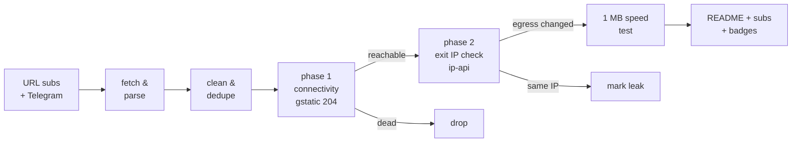

# Free Proxy Scanner

> **Really tested** free proxy aggregator. Every proxy below was fetched from public sources, tunneled through with Xray/sing-box, and verified to actually change your egress IP. No CSV-validation theater, no blind relisting.

      

## What this is

A GitHub Actions pipeline (runs once a day) that fetches free proxy configs from **173 URL subscriptions** and **81 Telegram channels**, parses 9 protocols (vless / vmess / trojan / ss / hysteria2 / hysteria / tuic / socks / http), deduplicates them, and **actually connects through every single one** to separate working proxies from dead ones.

Latest run: **2026-11-13 02:54:03 UTC** — 177007 unique proxies collected from 173/173 URL sources and 81/81 Telegram channels; **4507** endpoints really tested, **1150** reachable, **1119** verified working (egress IP confirmed changed) across **47 exit countries**.

## How the testing works (the *really* part)



1. **Phase 1 — connectivity.** Each proxy is loaded as an outbound into a real Xray or sing-box instance (or used directly via `curl -x` for plain http/socks). An HTTPS request to `gstatic.com/generate_204` goes through the tunnel with **DNS resolved on the proxy side**. Only an HTTP 204 counts as reachable.
2. **Phase 2 — egress verification.** An ip-api request through the same tunnel must return an exit IP **different from the runner's own IP**, plus its country and AS. Proxies that pass phase 1 but keep your IP are marked as leaks and excluded from the working list. Server country vs exit country mismatches are flagged in the tables.
3. **Throughput.** Working proxies download 1 MB from `speed.cloudflare.com` through the tunnel; the measured rate is the speed you see in the tables.
4. **Engine fallback.** If a proxy fails on Xray, it is retried on sing-box (and vice versa) before being declared dead — some configs only work on one core.

## Top working proxies

All 1119 working proxies are published in [`subs/all.txt`](subs/all.txt); this table shows the top 25.

| # | proxy | proto | server | exit | latency | speed | engine |
|---|-------|-------|--------|------|---------|-------|--------|
| 1 | #1 🇺🇸 US → 🇺🇸 US | `vless` | `67.220.73.204:18662` | United States | 129 ms | 56.3 Mbps | xray |
| 2 | #2 ❓ ?? → 🇺🇸 US | `ss` | `38.64.138.135:19999` | United States | 1127 ms | 50.5 Mbps | xray |
| 3 | #3 ❓ ?? → 🇺🇸 US | `vmess` | `38.128.66.241:1270` | United States | 115 ms | 49.2 Mbps | xray |
| 4 | #4 ❓ ?? → 🇺🇸 US | `trojan` | `216.152.155.50:443` | United States | 58 ms | 48.7 Mbps | xray |
| 5 | #5 ❓ ?? → 🇺🇸 US | `vmess` | `38.64.138.187:1270` | United States | 110 ms | 48.4 Mbps | xray |
| 6 | #6 ❓ ?? → 🇺🇸 US | `vmess` | `38.128.66.249:1270` | United States | 94 ms | 44.2 Mbps | xray |
| 7 | #7 🇺🇸 US → 🇺🇸 US | `ss` | `156.146.38.167:443` | United States | 58 ms | 43.4 Mbps | xray |
| 8 | #8 🇺🇸 US → 🇺🇸 US | `ss` | `156.146.38.170:443` | United States | 69 ms | 42.7 Mbps | xray |
| 9 | #9 ❓ ?? → 🇺🇸 US | `ss` | `38.128.66.32:19999` | United States | 56 ms | 42.0 Mbps | xray |
| 10 | #10 ❓ ?? → 🇺🇸 US | `ss` | `167.17.67.171:19999` | United States | 55 ms | 41.2 Mbps | xray |
| 11 | #11 ❓ ?? → 🇺🇸 US | `trojan` | `66.23.203.21:59689` | United States | 86 ms | 41.0 Mbps | singbox |
| 12 | #12 🇺🇸 US → 🇺🇸 US | `ss` | `156.146.38.168:443` | United States | 61 ms | 40.9 Mbps | xray |
| 13 | #13 ❓ ?? → 🇺🇸 US | `vmess` | `167.88.62.51:1270` | United States | 85 ms | 40.9 Mbps | xray |
| 14 | #14 ❓ ?? → 🇺🇸 US | `vmess` | `162.251.60.97:1270` | United States | 77 ms | 40.1 Mbps | xray |
| 15 | #15 🇨🇦 CA → 🇺🇸 US | `vmess` | `188.114.97.6:80` | United States | 3335 ms | 40.0 Mbps | xray |
| 16 | #16 ❓ ?? → 🇺🇸 US | `ss` | `167.88.62.203:19999` | United States | 62 ms | 39.1 Mbps | xray |
| 17 | #17 ❓ ?? → 🇺🇸 US | `trojan` | `216.152.155.176:443` | United States | 78 ms | 39.1 Mbps | xray |
| 18 | #18 ❓ ?? → 🇺🇸 US | `vmess` | `172.67.152.183:443` | United States | 2743 ms | 38.7 Mbps | xray |
| 19 | #19 ❓ ?? → 🇺🇸 US | `trojan` | `170.101.101.211:443` | United States | 127 ms | 36.7 Mbps | xray |
| 20 | #20 ❓ ?? → 🇺🇸 US | `vmess` | `172.64.229.21:443` | United States | 6722 ms | 35.4 Mbps | xray |
| 21 | #21 ❓ ?? → 🇺🇸 US | `trojan` | `216.152.155.59:443` | United States | 67 ms | 33.6 Mbps | singbox |
| 22 | #22 ❓ ?? → 🇺🇸 US | `ss` | `185.230.230.18:19999` | United States | 145 ms | 33.5 Mbps | xray |
| 23 | #23 🇺🇸 US → 🇺🇸 US | `vless` | `69.48.201.136:30016` | United States | 164 ms | 33.5 Mbps | singbox |
| 24 | #24 ❓ ?? → 🇨🇦 CA | `trojan` | `216.152.147.79:443` | Canada | 109 ms | 32.7 Mbps | xray |
| 25 | #25 🇺🇸 US → 🇺🇸 US | `ss` | `156.146.38.169:443` | United States | 60 ms | 32.5 Mbps | xray |

## Exit locations — which countries work

Every working proxy, grouped by the country of its **verified exit IP** (phase 2), with a dedicated subscription file per country. Currently 47 countries have at least one working exit.

| country | working | avg speed | best latency | share | list |
|---------|--------:|----------:|-------------:|------:|------|
| 🇺🇸 United States | 329 | 17.6 Mbps | 55 ms | 29% | [`US.txt`](subs/by-country/US.txt) |
| 🇳🇱 Netherlands | 148 | 6.8 Mbps | 325 ms | 13% | [`NL.txt`](subs/by-country/NL.txt) |
| 🇩🇪 Germany | 103 | 5.8 Mbps | 338 ms | 9% | [`DE.txt`](subs/by-country/DE.txt) |
| 🇯🇵 Japan | 84 | 2.8 Mbps | 426 ms | 8% | [`JP.txt`](subs/by-country/JP.txt) |
| 🇫🇷 France | 47 | 5.8 Mbps | 348 ms | 4% | [`FR.txt`](subs/by-country/FR.txt) |
| 🇨🇦 Canada | 42 | 12.1 Mbps | 109 ms | 4% | [`CA.txt`](subs/by-country/CA.txt) |
| 🇸🇬 Singapore | 36 | 3.4 Mbps | 593 ms | 3% | [`SG.txt`](subs/by-country/SG.txt) |
| 🇬🇧 United Kingdom | 35 | 6.3 Mbps | 325 ms | 3% | [`GB.txt`](subs/by-country/GB.txt) |
| 🇪🇸 Spain | 27 | 5.8 Mbps | 413 ms | 2% | [`ES.txt`](subs/by-country/ES.txt) |
| 🇫🇮 Finland | 23 | 5.5 Mbps | 395 ms | 2% | [`FI.txt`](subs/by-country/FI.txt) |
| 🇮🇹 Italy | 22 | 6.4 Mbps | 385 ms | 2% | [`IT.txt`](subs/by-country/IT.txt) |
| 🇦🇺 Australia | 17 | 9.9 Mbps | 102 ms | 2% | [`AU.txt`](subs/by-country/AU.txt) |
| 🇧🇾 BY | 17 | 4.5 Mbps | 460 ms | 2% | [`BY.txt`](subs/by-country/BY.txt) |
| 🇵🇱 Poland | 17 | 4.6 Mbps | 525 ms | 2% | [`PL.txt`](subs/by-country/PL.txt) |
| 🇸🇪 Sweden | 16 | 5.6 Mbps | 414 ms | 1% | [`SE.txt`](subs/by-country/SE.txt) |
| 🇭🇰 Hong Kong | 15 | 2.7 Mbps | 554 ms | 1% | [`HK.txt`](subs/by-country/HK.txt) |
| 🇮🇳 India | 15 | 3.2 Mbps | 822 ms | 1% | [`IN.txt`](subs/by-country/IN.txt) |
| 🇨🇭 Switzerland | 14 | 5.5 Mbps | 392 ms | 1% | [`CH.txt`](subs/by-country/CH.txt) |
| 🇰🇷 South Korea | 10 | 5.1 Mbps | 592 ms | 1% | [`KR.txt`](subs/by-country/KR.txt) |
| 🇦🇱 AL | 9 | 3.5 Mbps | 637 ms | 1% | [`AL.txt`](subs/by-country/AL.txt) |
| 🇹🇷 Turkey | 8 | 5.0 Mbps | 658 ms | 1% | [`TR.txt`](subs/by-country/TR.txt) |
| 🇹🇼 Taiwan | 8 | 3.1 Mbps | 518 ms | 1% | [`TW.txt`](subs/by-country/TW.txt) |
| 🇪🇪 Estonia | 7 | 5.7 Mbps | 419 ms | 1% | [`EE.txt`](subs/by-country/EE.txt) |
| 🇷🇺 Russia | 7 | 5.1 Mbps | 558 ms | 1% | [`RU.txt`](subs/by-country/RU.txt) |
| 🇰🇿 Kazakhstan | 7 | 3.0 Mbps | 1446 ms | 1% | [`KZ.txt`](subs/by-country/KZ.txt) |
| 🇦🇹 Austria | 6 | 6.4 Mbps | 424 ms | 1% | [`AT.txt`](subs/by-country/AT.txt) |
| 🇷🇴 Romania | 6 | 5.3 Mbps | 696 ms | 1% | [`RO.txt`](subs/by-country/RO.txt) |
| 🇦🇪 UAE | 6 | 3.4 Mbps | 853 ms | 1% | [`AE.txt`](subs/by-country/AE.txt) |
| 🇱🇻 Latvia | 5 | 5.9 Mbps | 576 ms | 0% | [`LV.txt`](subs/by-country/LV.txt) |
| 🇮🇷 Iran | 5 | 4.3 Mbps | 1205 ms | 0% | [`IR.txt`](subs/by-country/IR.txt) |
| 🇺🇦 Ukraine | 3 | 6.3 Mbps | 725 ms | 0% | [`UA.txt`](subs/by-country/UA.txt) |
| 🇨🇿 Czechia | 3 | 6.3 Mbps | 522 ms | 0% | [`CZ.txt`](subs/by-country/CZ.txt) |
| 🇧🇷 Brazil | 3 | 5.5 Mbps | 644 ms | 0% | [`BR.txt`](subs/by-country/BR.txt) |
| 🇬🇷 Greece | 3 | 1.5 Mbps | 665 ms | 0% | [`GR.txt`](subs/by-country/GR.txt) |
| 🇲🇽 Mexico | 2 | 9.5 Mbps | 293 ms | 0% | [`MX.txt`](subs/by-country/MX.txt) |
| 🇲🇾 Malaysia | 2 | 2.7 Mbps | 840 ms | 0% | [`MY.txt`](subs/by-country/MY.txt) |
| 🇿🇦 South Africa | 2 | 3.8 Mbps | 880 ms | 0% | [`ZA.txt`](subs/by-country/ZA.txt) |
| 🇮🇪 Ireland | 1 | 9.2 Mbps | 310 ms | 0% | [`IE.txt`](subs/by-country/IE.txt) |
| 🇧🇪 Belgium | 1 | 7.8 Mbps | 512 ms | 0% | [`BE.txt`](subs/by-country/BE.txt) |
| 🇨🇱 Chile | 1 | 6.4 Mbps | 527 ms | 0% | [`CL.txt`](subs/by-country/CL.txt) |
| 🇮🇱 Israel | 1 | 6.0 Mbps | 617 ms | 0% | [`IL.txt`](subs/by-country/IL.txt) |
| 🇧🇬 Bulgaria | 1 | 5.7 Mbps | 678 ms | 0% | [`BG.txt`](subs/by-country/BG.txt) |
| 🇸🇦 Saudi Arabia | 1 | 5.0 Mbps | 883 ms | 0% | [`SA.txt`](subs/by-country/SA.txt) |
| 🇹🇭 Thailand | 1 | 4.1 Mbps | 821 ms | 0% | [`TH.txt`](subs/by-country/TH.txt) |
| 🇳🇴 Norway | 1 | 2.0 Mbps | 430 ms | 0% | [`NO.txt`](subs/by-country/NO.txt) |
| 🇻🇳 Vietnam | 1 | 1.9 Mbps | 1041 ms | 0% | [`VN.txt`](subs/by-country/VN.txt) |
| 🇳🇬 NG | 1 | - | 1510 ms | 0% | [`NG.txt`](subs/by-country/NG.txt) |

A `??` exit means the geo lookup could not resolve the exit IP. Base64 variants of every country file sit next to them as `<CC>.base64.txt`.

## Protocol distribution

| protocol | tested | alive | working | alive rate |
|----------|-------:|------:|--------:|-----------:|
| `vless` | 2756 | 592 | 567 | 21% |
| `ss` | 609 | 252 | 249 | 41% |
| `vmess` | 885 | 159 | 156 | 18% |
| `trojan` | 176 | 113 | 113 | 64% |
| `hysteria2` | 73 | 33 | 33 | 45% |
| `socks` | 2 | 1 | 1 | 50% |
| `http` | 5 | 0 | 0 | 0% |
| `tuic` | 1 | 0 | 0 | 0% |

Per-protocol working lists: [`subs/by-proto/`](subs/by-proto/) (one `vless.txt`, `vmess.txt`, ... per protocol, plus `.base64.txt` variants).

## Engine breakdown

Which core verified each working proxy. The engine fallback means a proxy that failed on its primary core got a second chance on the other one.

| engine | working | note |
|--------|--------:|------|
| Xray-core | 1004 | [`allxray.txt`](subs/by-engine/allxray.txt) |
| sing-box | 114 | [`allsingbox.txt`](subs/by-engine/allsingbox.txt) |
| direct (curl) | 1 | plain http/socks, [`alldirect.txt`](subs/by-engine/alldirect.txt) |

## Speed & latency profile

| speed tier | proxies |
|-----------|--------:|
| >= 5 Mbps | 685 |
| 1 - 5 Mbps | 267 |
| 0.25 - 1 Mbps | 26 |
| < 0.25 Mbps | 0 |
| unmeasured | 141 |

Latency (phase-1 HTTPS round trip): median **545 ms**, p90 **2515 ms**. 31 proxies passed connectivity but failed egress verification (leaked the runner IP or broke on the exit check) and are excluded.

## Source health

254 active, 0 auto-retired (10 fetch failures / 10 all-dead runs / 10 days without anything new). Best contributors this run:

| source | kind | tested | alive | new this run |
|--------|------|-------:|------:|-------------:|
| `NK` | url | 1023 | 631 | 7612 |
| `EV` | url | 733 | 614 | 96 |
| `SK` | url | 993 | 599 | 193 |
| `HP` | url | 415 | 383 | 62 |
| `RD-VL` | url | 2258 | 349 | 3565 |
| `AG-PL` | url | 501 | 321 | 664 |
| `Ni` | url | 343 | 262 | 110 |
| `EV-VL` | url | 345 | 259 | 730 |
| `ET` | url | 388 | 250 | 1964 |
| `RD-SS` | url | 551 | 249 | 366 |
| `F0` | url | 245 | 236 | 0 |
| `EV-SS` | url | 236 | 228 | 137 |
| `SB` | url | 2259 | 220 | 7 |
| `ST-VL` | url | 2125 | 211 | 746 |
| `KA` | url | 2606 | 196 | 6911 |
| `HC` | url | 780 | 171 | 67 |
| `RD-VM` | url | 632 | 150 | 3677 |
| `LA` | url | 753 | 141 | 13610 |
| `ST-VM` | url | 631 | 132 | 37 |
| `EP-ALL` | url | 1325 | 124 | 0 |

## History

working per run (last 26): ▁▁▆▆▆▇▆▆▆█▇▆▇▆▆▆█▆▆▇██████

| date (UTC) | tested | alive | working | avg | max |
|------------|-------:|------:|--------:|----:|----:|
| 2026-11-13 03:31 | 4507 | 1150 | 1119 | 9.4M | 56.3M |
| 2026-11-12 03:35 | 4512 | 1209 | 1166 | 7.0M | 73.5M |
| 2026-11-11 03:35 | 4521 | 1141 | 1102 | 10.1M | 108.1M |
| 2026-11-10 03:31 | 4511 | 1098 | 1052 | 8.2M | 76.8M |
| 2026-11-09 03:34 | 4509 | 1081 | 1046 | 7.6M | 96.5M |
| 2026-11-08 03:39 | 4502 | 1098 | 1068 | 7.7M | 107.7M |
| 2026-11-07 03:34 | 4503 | 1040 | 994 | 7.6M | 82.2M |
| 2026-11-06 10:53 | 4846 | 900 | 837 | 8.5M | 49.1M |
| 2026-10-03 11:04 | 4500 | 899 | 860 | 8.7M | 82.3M |
| 2026-10-03 02:52 | 4500 | 1062 | 1030 | 8.0M | 75.5M |
| 2026-10-02 21:49 | 4500 | 890 | 861 | 8.9M | 68.7M |
| 2026-10-02 17:14 | 4500 | 847 | 807 | 8.6M | 88.1M |
| 2026-10-02 11:49 | 4500 | 861 | 798 | 7.9M | 85.3M |
| 2026-10-01 22:23 | 4500 | 904 | 878 | 7.5M | 90.2M |
| 2026-10-01 17:56 | 4500 | 861 | 794 | 7.3M | 58.6M |

## Subscription files

Everything under [`subs/`](subs/) is regenerated every run. Plain lists are one proxy URI per line; `.base64.txt` variants are the same list base64-encoded for clients that need the classic sub format.

| file | contents | direct subscription URL |
|------|----------|--------------------------|
| [`all.txt`](subs/all.txt) | ALL working proxies, ranked by speed (1119) | `https://raw.githubusercontent.com/onlyactions/proxy-scanner/main/subs/all.txt` |
| [`all.base64.txt`](subs/all.base64.txt) | same, base64 | `https://raw.githubusercontent.com/onlyactions/proxy-scanner/main/subs/all.base64.txt` |
| [`top150.txt`](subs/top150.txt) | top 150 ranked (150) | `https://raw.githubusercontent.com/onlyactions/proxy-scanner/main/subs/top150.txt` |
| [`top150.base64.txt`](subs/top150.base64.txt) | same, base64 | `https://raw.githubusercontent.com/onlyactions/proxy-scanner/main/subs/top150.base64.txt` |
| [`by-proto/`](subs/by-proto/) | one list per protocol (6 protocols) | ...`/subs/by-proto/<proto>.txt` |
| [`by-engine/allxray.txt`](subs/by-engine/allxray.txt) | verified on Xray (1004) | `https://raw.githubusercontent.com/onlyactions/proxy-scanner/main/subs/by-engine/allxray.txt` |
| [`by-engine/allsingbox.txt`](subs/by-engine/allsingbox.txt) | verified on sing-box (114) | `https://raw.githubusercontent.com/onlyactions/proxy-scanner/main/subs/by-engine/allsingbox.txt` |
| [`by-country/`](subs/by-country/) | one list per exit country (47 countries, e.g. [`US.txt`](subs/by-country/US.txt), [`DE.txt`](subs/by-country/DE.txt)) | ...`/subs/by-country/<CC>.txt` |
| [`sing-box-client.json`](subs/sing-box-client.json) | top 150 as a ready-to-run sing-box client config | `https://raw.githubusercontent.com/onlyactions/proxy-scanner/main/subs/sing-box-client.json` |
| [`xray-client.json`](subs/xray-client.json) | top 150 as a ready-to-run xray client config | `https://raw.githubusercontent.com/onlyactions/proxy-scanner/main/subs/xray-client.json` |
| [`archive/`](archive/) | gz snapshot of every collection (30 kept) | — |

## Use the proxies

- **v2rayN / v2rayNG / Nekobox / Hiddify / Shadowrocket**: add subscription `https://raw.githubusercontent.com/onlyactions/proxy-scanner/main/subs/all.base64.txt` (everything working) or `https://raw.githubusercontent.com/onlyactions/proxy-scanner/main/subs/top150.base64.txt` (curated top 150).
- **Want a specific country?** Grab `subs/by-country/<CC>.txt` (see the Exit locations table above) — e.g. `https://raw.githubusercontent.com/onlyactions/proxy-scanner/main/subs/by-country/US.txt`, `https://raw.githubusercontent.com/onlyactions/proxy-scanner/main/subs/by-country/DE.txt`.
- **Only one protocol?** `subs/by-proto/<proto>.txt` — e.g. `https://raw.githubusercontent.com/onlyactions/proxy-scanner/main/subs/by-proto/vless.txt`, `https://raw.githubusercontent.com/onlyactions/proxy-scanner/main/subs/by-proto/hysteria2.txt`.
- **sing-box**: download [`subs/sing-box-client.json`](subs/sing-box-client.json) and run `sing-box run -c sing-box-client.json` — it listens on `127.0.0.1:2080` (mixed) with a selector + auto urltest group.
- **Xray**: download [`subs/xray-client.json`](subs/xray-client.json), socks inbound on `127.0.0.1:2080`.
- Raw snapshots of every collection: [`archive/`](archive/) (30 kept).

## Repository layout

```
sources/            url_subs.yml + telegram.yml (scannable source lists)
scripts/            collect.py, test.py, report.py + lib/
state/              source health, alive-recall pool, geo cache (committed)
data/               stats, history, compact last-run results
subs/               THE PRODUCT: verified working proxies, split by
                    proto / engine / exit country + all + top150 lists
badges/             shields.io endpoint badges
archive/            gz snapshots of every collection
```

## Why most "free proxy lists" lie

The typical aggregator relists whatever it scraped, so 80-95% of entries are dead within hours — this run found **74% unreachable** and **75% unusable** overall. Only tunnels that completed a real HTTPS handshake, returned a verifiable foreign exit IP, and pushed a 1 MB download are counted as working here.

## Disclaimers

- Free proxies are **public and untrusted**. Anything you send through them can be observed or modified by their operators. Never use them for authentication, payments, or anything sensitive.
- All configs are collected from publicly posted sources (GitHub subscriptions and public Telegram channels); no credentials are guessed or brute-forced. Removal requests: open an issue.
- Availability is transient: the working list is re-verified daily, and past performance never guarantees future availability.

